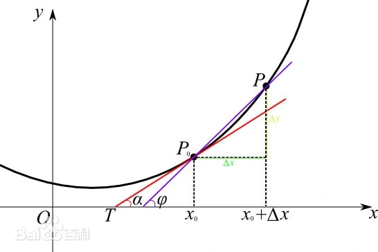

# 导数 (Derivative)

1. 核心概念: 当函数的自变量Δx趋近于0的时候，如果存在式子里面的值，那么函数可导
2. 定义: 当函数$ y=f(x)$的自变量x在一点$x_0$上产生一个增量Δx时，函数输出值的增量$Δy=f(x_0+Δx)-f(x_0)$与自变量增量Δx的比值在Δx趋于0时的极限a如果存在，a即为在x0处的导数，记作$ f’(x_0)$ 或$df(x_0)/dx$，即：$\frac{Δy}{Δx}$。
3. 代表符号: $ f'(x) $，即求导
4. 公式: $ (f'(x_0)=\lim\limits_{x \to x_0}\frac{f(x_0+Δx)-f(x_0)}{Δx}) $
5. 理解: (函数在某点的“瞬时变化率”)
    1. 点${P_0}$ 到 点${P}$连成的直线（紫色线），与$x轴$形成夹角$\phi$
    2. 当Δx趋近于0时，$P_0$点与函数形成切线（红色线），与$x轴形成夹角\alpha$
    3. $P$点减去$P_0$点 得 $Δy$(黄色字)
    4. $x_0+Δx$减去$x_0$ 得 $Δx$(绿色字)
    5. 当 $Δx \to 0 $时，$x_0 = x_0 + Δx$
6. 几何意义: 导数就是曲线在该点的切线斜率
7. 左导数、右导数
     1. 导数本质是一个极限，而极限分左右。
     2. 从左边趋近于0的是左导数，反之是右导数
     3. 左导数：$ f'_-(x_0) = \lim\limits_{\Delta x \to x_0^-} \frac{f(x_0+\Delta x)-f(x_0)}{\Delta x} $
     4. 右导数：$ f'_+(x_0) = \lim\limits_{\Delta x \to x_0^+} \frac{f(x_0+\Delta x)-f(x_0)}{\Delta x} $
     5. 函数在 $x_0$可导的充要条件是: $ f'_-(x_0) = f'_+(x_0) $
     6. 列：
         1. $ f(x) = |x| $
             - 在 x=0 处
               - 左侧 f(x)=−x ，斜率为 −1
               - 右侧 f(x)=x ，斜率为 1
             - 左右导数不相等，因此$ f(x)=∣x∣ $在 x=0 处不可导
## 一阶导数
1. 一阶导数判别法：
    - 若 $f′(x)$ 从正变负，则 $x_0$是极大值；
    - 若 $f′(x)$ 从负变正，则 $x_0$是极小值；
## 二阶导数
1. 二阶导数判别法
    - $ f′′(x_0)<0 $: 极大值；
    - $ f′′(x_0)>0 $: 极小值；
    - $ f′′(x_0)=0 $: 无法判断；
## 导数四则运算法则
1. 加法与减法法则(线性法则)
2. 乘法法则
3. 除法法则
4. 常数倍数法则(数乘)

## 泰勒公式
